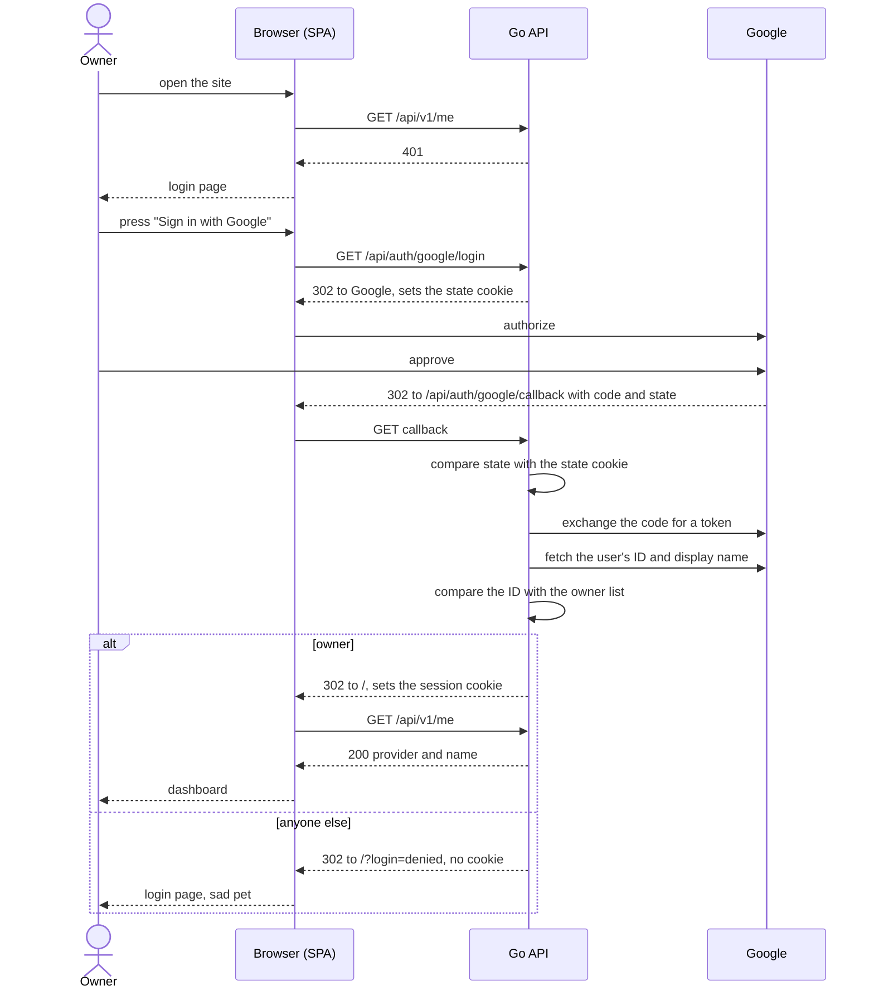

# Login, phase 1: Google sign-in for the owner

Status: implemented on the working tree and reviewed (`/interrogate`, then `/code-review`), not yet committed. Verified in a browser against a local fake provider. Not yet run against real Google, because the OAuth clients in Rollout do not exist yet.

## Goal

Lock the dashboard so that only the owner can read its data, before real data replaces the demo data. The owner signs in with their Google account and stays signed in for 30 days.

This is the first of the phases below. Phase 1 needs no storage and no Go dependency.

| Phase | Adds | Needs storage | Needs a Go dependency |
| ----- | ---- | ------------- | --------------------- |
| 1 (this spec) | API gate, session cookie, login page, logout, Google sign-in for the owner only | No | No |
| 1b | GitHub sign-in as a second provider for the owner | No | No |
| 2 | Passkeys, including adding one | Yes | Probably |
| 3 | Open registration: the owner sees real data, other registered users see demo data. `PRODUCT.md` is rewritten. | Yes | Decided in phase 2 |

Phase 1b is already decided and is a small addition to this design: one more provider behind the same routes, plus `GITHUB_CLIENT_ID`, `GITHUB_CLIENT_SECRET` and `OWNER_GITHUB_ID`. Phases 2 and 3 get their own grilling and spec when their turn comes.

## Non-goals for phase 1

- GitHub sign-in. It is phase 1b.
- Passkeys, registration, and any second role. Only the owner exists.
- A database or any other persistent storage.
- Two-factor authentication.
- A UI for linking or unlinking sign-in methods. When phase 1b adds GitHub, both identities are listed in configuration and treated as the same person.
- Changes to the nginx config on the VM.
- Frontend tests. There is no test runner in `web/`, and this phase does not add one.

## Rules and examples

### R1. Every API route needs a session unless it is explicitly public

The gate denies by default, so a module added later is protected without anyone remembering to protect it. The public routes are `GET /api/health` and the three sign-in routes: login, callback, and logout. The gate decides by the route pattern a request matches, not by its path prefix, so nothing else under `/api/auth/` is public and a wildcard route elsewhere cannot be reached through that prefix.

- No cookie, `GET /api/v1/overview`: 401.
- No cookie, `GET /api/health`: 200 `ok`. The deploy check depends on this.
- No cookie, `GET /api/v1/does-not-exist`: 401, not 404.
- No cookie, `GET /api/auth/does-not-exist`: 401.
- A later module registers `GET /api/{module}/summary`. No cookie, `GET /api/auth/summary`: 401.
- Valid owner cookie, `GET /api/v1/overview`: 200 with the data.

### R2. Only an owner identity gets a session

An identity is a provider plus that provider's permanent user ID, which for Google is `sub`. Email addresses and display names are never compared, because they can change or be re-registered by someone else.

- Google user whose `sub` equals `OWNER_GOOGLE_SUB` completes sign-in: session cookie set, redirect to `/`.
- Any other Google user completes sign-in: no cookie, redirect to `/?login=denied`, and the API logs the provider and the ID that was refused.
- A Google account with the owner's email address but a different `sub`: denied.

The log line in the second example is also how the owner finds their own `sub` the first time (see Rollout).

### R3. A session lasts a fixed 30 days

- Signed in on 1 November, request on 30 November: allowed.
- Same session, request on 2 December: 401. Using the dashboard in between did not extend it.

### R4. The owner list is checked on every request

- A valid, unexpired cookie for Google `sub` `123`; the owner changes `OWNER_GOOGLE_SUB` in `.env` and recreates the API container: 401 on the next request. A plain `docker compose restart` does not reload `.env`.

### R5. A cookie that was not signed by this server is rejected

- Payload edited to another user ID, signature left alone: 401.
- Cookie signed with a previous `SESSION_KEY`: 401. Rotating the key signs everyone out.

### R6. The OAuth callback must match the request that started it

- Callback whose `state` does not match the state cookie, or arrives without one: no session, redirect to `/?login=failed`.
- The provider returns an error, including the user pressing Cancel: no session, redirect to `/?login=failed`.
- The provider is unreachable during the code exchange: no session, redirect to `/?login=failed`.

### R7. The API refuses to start with incomplete configuration

There is no unprotected fallback and no development bypass.

- `SESSION_KEY` missing or shorter than 32 bytes: the process exits non-zero with a message naming the variable. The value is never printed.
- `PUBLIC_URL`, the Google client ID, the Google client secret, or `OWNER_GOOGLE_SUB` missing: same.

### R8. The frontend shows the login page whenever there is no session

- Opening the site without a session: a full-page login screen with no sidebar. The pet dozes on the sky field; the bubble asks the owner to sign in; one button, "Sign in with Google". Phase 1b adds a second button beside it.
- A session expires while Overview is open and the next request returns 401: the app switches to the login page.
- Landing on `/?login=denied`: the pet is sad on the pink field and the bubble says this account has no access. The query string is then removed from the address bar.
- Landing on `/?login=failed`: the pet is dizzy on the pink field and the bubble says sign-in did not finish and to try again.
- The API is unreachable when the app starts: the pet is dizzy with a retry button, as on Overview today. This is not the login page, because the session state is unknown. Pressing retry shows the sleepy pet until the check returns.
- While the first session check is in flight, nothing is rendered, so the login page never flashes for a signed-in owner.
- The first session check gets no answer for 10 seconds: the app stops waiting and shows the unreachable page with its retry button.
- The owner signs in from `/#/settings`, either after an expired session or from a bookmark: after sign-in they are back on Settings, not Overview.

### R9. Logout is in Settings

- Settings shows which provider and display name the owner signed in with, beside a logout button.
- Pressing it clears the cookie and shows the login page.

## Interaction flow

## Design

### API

| Route | Access | Behaviour |
| ----- | ------ | --------- |
| `GET /api/health` | public | Unchanged. |
| `GET /api/auth/{provider}/login` | public | Sets the state cookie and redirects to the provider. `provider` is `google`; anything else is 404. The request asks Google to show its account chooser, so an owner whose browser is signed in to another account can switch. |
| `GET /api/auth/{provider}/callback` | public | Rules R2 and R6. |
| `POST /api/auth/logout` | public | Clears the session cookie. 204. |
| `GET /api/v1/me` | session | `{ "provider": "google", "name": "..." }`. The frontend calls it at startup. |
| everything else | session | R1. |

The code lives in a new `api/internal/auth/` package, following the module pattern: `Register(mux)` for its routes, plus a gate that wraps the mux. `api/internal/server/` assembles the routes and the gate in one function that both `main.go` and the tests use. Handlers read the signed-in identity from the request context, so phase 3 can branch on role without reworking the gate.

The provider name stays in the route and in the session payload, so adding GitHub in phase 1b changes no URL and invalidates no session. What differs per provider (authorize URL, code exchange, identity lookup) is kept together, with the provider's base URLs configurable so tests can point at a local fake.

**Google**: authorization code flow with scope `openid profile`; identity from the OpenID Connect userinfo endpoint (`sub`, `name`). Calling userinfo over TLS with the token just obtained avoids verifying an ID token signature, which keeps this inside the standard library.

### Session cookie

- Value: a payload (provider, user ID, display name, expiry) and an HMAC-SHA256 signature over it, keyed by `SESSION_KEY`. The signature is compared in constant time.
- Attributes: `HttpOnly`, `SameSite=Strict`, `Path=/`, `Max-Age` of 30 days, and `Secure` when `PUBLIC_URL` is https.
- `SameSite=Strict` works here because the page shell is static and public; the cookie is only needed on the app's own same-site `fetch` calls.

The state cookie is separate: random, `HttpOnly`, `SameSite=Lax` so that it survives the redirect back from the provider, scoped to `/api/auth`, and valid for 10 minutes.

### Configuration

All read from the environment at startup (R7).

| Variable | Meaning |
| -------- | ------- |
| `PUBLIC_URL` | The site's origin, such as `https://stanmao.com` or `http://localhost:5173`. Used to build callback URLs and to decide the `Secure` flag. It must be a bare origin: a trailing slash or a path is a startup error, because either would produce a callback URL that Google rejects. |
| `SESSION_KEY` | Random signing key, at least 32 bytes. |
| `GOOGLE_CLIENT_ID`, `GOOGLE_CLIENT_SECRET` | Google OAuth client. |
| `OWNER_GOOGLE_SUB` | The owner's Google identity (R2). |

- **Production**: `~/apps/dashboard/.env` on the VM, created by hand and read through `env_file` in `deploy/compose.yaml`. Deploys never write it.
- **Development**: `api/.env`, ignored by git, loaded by `make api`. A committed `api/.env.example` lists the variables without values. Development uses its own Google OAuth client, with the callback on `http://localhost:5173/api/auth/google/callback`; Vite's existing `/api` proxy carries it to the Go server.
- Values are plain `KEY=value` with no quotes, so the same file format works for both Docker Compose and the shell.

### Frontend

- `web/src/api.ts`: a 401 from any request is reported to the app as "signed out", distinct from other errors.
- `web/src/App.tsx`: checks `GET /api/v1/me` before rendering. Signed in: the existing shell. Signed out: the login page instead of the shell.
- `web/src/pages/Login.tsx`: the login page (R8). It is not an entry in `modules.tsx`, because it is not a sidebar module.
- `web/src/pages/Settings.tsx`: the signed-in account and the logout button (R9).
- `web/src/i18n/en.json` and `zh-Hant.json`: every new string, in both.

Design-system notes:

- The pet stage and speech bubble are reused as they are. Mood to field mapping is unchanged: sleepy on sky, sad and dizzy on pink.
- The sign-in button is a new component: a full pill in solid sky with the fixed navy ink, the same treatment as the selected choice chip, with a monochrome provider mark drawn inline (lucide-react ships no brand icons). It sits in the speech bubble, where Overview puts its retry button. A surface-coloured pill would disappear against the bubble. It is added to `DESIGN.md` when built.
- The stage and bubble markup moves out of `Overview.tsx` into a shared component, so Overview and the login page render the same one.
- The brand pet in the shell stays still, so the login page's pet is the only animated one.

### Deploy

- `deploy/compose.yaml` gains `env_file: .env`.
- `make deploy` runs the tests first.
- Before it replaces anything on the VM, `make deploy` checks that `.env` exists, uploads the new binary beside the running one, and runs it there as `server check-config`. A missing or invalid `.env` stops the deploy with the configuration error and leaves the running API as it was. Without this, a first deploy would replace a working API with one that refuses to start.
- If the health check after the swap fails, `make deploy` prints the API's recent log.

### Tests

Go tests in `api/internal/auth/`, the first tests in the repository:

- Cookie: round trip, tampered payload, wrong key, expired.
- Gate: public routes pass; protected routes return 401 without a cookie, 200 with an owner cookie, and 401 with a valid cookie whose identity is no longer an owner.
- Callback, against a fake provider: owner gets a cookie; another user gets none and is redirected to `?login=denied`; mismatched or missing state is redirected to `?login=failed`.
- Configuration: each missing or too-short value stops startup.

### Documentation to update

`README.md` (development now needs `api/.env`; the VM table gains `.env`), `CLAUDE.md` (the gate, the public-route list, how to run the Go tests), `DESIGN.md` (sign-in button, login page), and `PRODUCT.md` (sign-in exists; the owner is still the only user).

## Rollout

These steps are manual and must be finished before the change reaches `main`, because pushing to `main` deploys.

1. Create two Google OAuth clients in Google Cloud, one for production and one for development, each with its callback URL registered.
2. Generate two signing keys, one per environment.
3. Fill in `api/.env` locally and `~/apps/dashboard/.env` on the VM.
4. Find the owner's `sub`: sign in once with `OWNER_GOOGLE_SUB` set to a placeholder; the refusal is logged with the `sub` to copy in. On the VM the log is `docker logs dashboard-api`, and the edited `.env` takes effect only after `docker compose up -d --force-recreate`.
5. Verify locally, then merge.

## Decision record

**Context.** The API had no authentication, no storage, and no dependencies, and the site is on a public address. Real data is coming. The owner also wants passkeys and open registration later, both of which need storage.

**Decision.**

1. Enforce access in the Go API with a deny-by-default gate, not in nginx. The rules then live in the repository, deploy with the code, and are testable; and the login page can follow the design system.
2. Use stateless signed cookies for sessions. Every deploy recreates the container, so in-memory sessions would sign the owner out on each one, and there is nowhere to persist them.
3. Authenticate through OAuth, with the owner's permanent provider ID in configuration: Google first, GitHub next as phase 1b. No password is stored or checked, so there is nothing to brute-force and no hashing to maintain.
4. Keep secrets in an `.env` file on the VM, outside the repository and untouched by deploys, so deploying from a laptop and from CI behave the same.
5. Fail closed: incomplete configuration stops the API from starting, and development uses real OAuth with its own credentials.

**Consequences.**

- The JavaScript bundle stays publicly downloadable. It contains no data, but its text and structure are visible to anyone.
- A single session cannot be revoked. A copied cookie works until it expires, the identity is removed from the owner list, or `SESSION_KEY` is rotated, which signs out every device.
- Local development no longer works on a fresh clone until `api/.env` exists.
- Production now depends on a hand-made file that is not in version control and has no backup beyond the VM.
- Mutating endpoints do not exist yet. When one is added, `SameSite=Strict` is its only cross-site request protection unless an origin check is added then.
- Phase 2 will have to choose storage, and will probably have to relax the standard-library-only rule for passkey verification.

## Open questions

None block phase 1. Deferred to their phases:

- Phase 2: where passkey public keys are stored, and whether a WebAuthn dependency is accepted.
- Phase 3: what a registered user's account consists of, how the owner role relates to the phase 1 owner list, and what personal data is kept.
